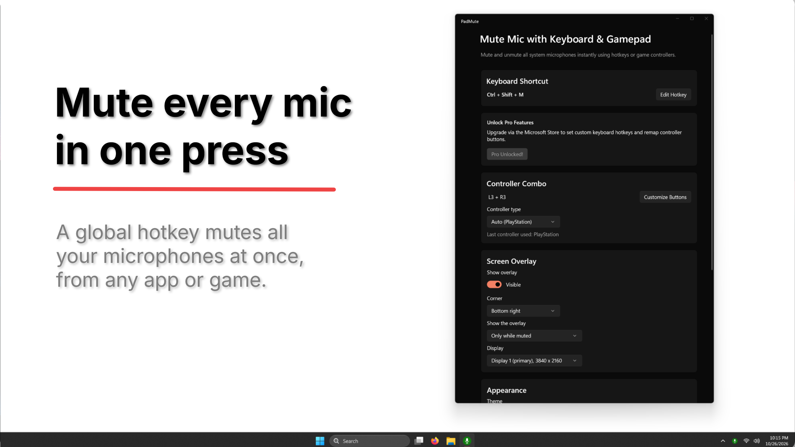
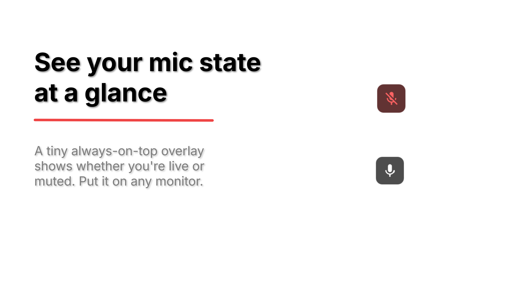

# PadMute: Mute Mic with Keyboard & Gamepad

  
  

  <em>The settings window (Left) and the always-on-top mic indicator (Right).</em>

  
  &nbsp;
  

---

## The Problem
Muting your microphone mid-game or mid-call usually means alt-tabbing, hunting for a button in a chat app, or digging through Windows sound settings. Every app has its own mute control, and it is easy to forget which mic is open.

**PadMute** fixes that at the Windows level. One keypress or one controller shortcut mutes or unmutes **all** of your microphones at once, from anywhere, even while a game is in front.

---

## Features

* **Global mute for every microphone:** Works with Discord, Teams, Zoom, OBS, in-game voice chat and any other app, because it acts on the Windows capture devices themselves.
* **Keyboard hotkey:** Ready out of the box with `Ctrl+Shift+M`.
* **Controller shortcut:** Squeeze both thumbsticks (`L3 + R3`) on your gamepad. It works from the system tray, with no window open, and in games.
* **Controller support:** Xbox Series controllers (USB or Bluetooth), PlayStation DualSense and DualShock 4 (USB or Bluetooth), and Nintendo Switch Pro Controller (Bluetooth). Button labels and glyphs match your pad, or you can pick a style.
* **Floating mic indicator:** A small borderless, click-through, always-on-top overlay shows live vs. muted without stealing focus from your game.
* **Pick your monitor:** Put the indicator on a second screen to keep it visible even when a game runs in exclusive fullscreen. The shortcuts work either way.
* **Windows 11 look:** Fluent design with Mica or Acrylic backdrops and light and dark themes.
* **Starts with Windows,** hidden in the tray. Closing the window never quits it.

---

## Free and Pro

| Feature | Free | Pro |
|---|:---:|:---:|
| Mute / unmute all microphones | ✅ | ✅ |
| Keyboard hotkey | `Ctrl+Shift+M` | Any combo you choose |
| Controller shortcut | `L3 + R3` | Any buttons you choose |
| Overlay position | Bottom-right | Any of the 4 corners |
| Hide the overlay | | ✅ |
| Overlay display mode (always / only while a mic is in use / only while muted) | Always | ✅ |
| Choose which monitor shows the overlay | ✅ | ✅ |
| Controller glyph styles (Xbox / PlayStation / Switch / Generic) | ✅ | ✅ |

PadMute Pro is a one-time purchase through the Microsoft Store.

---

## Private by Design

PadMute never records or listens to audio. It has no accounts, no ads and no analytics, makes no network requests of its own, and keeps all settings on your PC.

* [Privacy policy](https://peacefuldivide.github.io/padmute-legal/)

---

## Engineering & Architecture

PadMute is a native C++/WinRT application built on WinUI 3 and the Windows App SDK, packaged as MSIX.

* **Global hotkey:** Registered with `RegisterHotKey` on the UI thread, so it fires no matter which app has focus. A new hotkey is only saved after the registration succeeds, and the previous one is restored on failure.
* **Controller input that works from the tray:** In a packaged app, XInput is gated by window focus, so Xbox pads are read through **Raw Input** (`RIDEV_INPUTSINK`) and decoded from their HID reports. PlayStation and Switch pads use the same path. Every pad is converted to one XInput-style button mask, so the combo logic, labels and glyphs are shared across controller families.
* **Raw Input recovery:** When a game takes exclusive control of a device and its reports stop, PadMute detects the gap and recovers the stream. The app only reads from pads and never writes to them.
* **Tested on real hardware:** Controller support is verified on physical Xbox Series, PlayStation DualSense, DualShock 4 and Nintendo Switch Pro controllers, over USB and Bluetooth where each supports it, including in an exclusive-fullscreen game.
* **Core Audio:** Mute state is applied to every active capture endpoint through `IAudioEndpointVolume`. The overlay follows a change callback, so it updates for changes made outside the app too.
* **Overlay window:** A separate transparent top-most window (`WS_EX_TOOLWINDOW | WS_EX_NOACTIVATE | WS_EX_TRANSPARENT`) that is click-through and never takes focus.
* **Combo rules:** Custom controller combos and hotkeys are validated (2 to 4 buttons, no opposing D-pad directions, no reserved key combinations) before they are accepted.
* **Licensing enforced in behavior:** Pro is checked through `Windows.Services.Store` and feeds a single flag. When it is not confirmed, any saved Pro values are ignored and the free defaults apply, so a refunded or lapsed license falls back cleanly.
* **Modern Windows styling:** Mica and Acrylic system backdrops, an extended title bar, and theming that follows the system or a user override.

---

## Distribution & Licensing

PadMute is published as a managed application via **AltTab Technologies LLC**, using **MSIX packaging** and **Microsoft Store In-App Purchases (`StoreContext`)** for secure license validation and a durable one-time upgrade.

---

## Get PadMute

* **[Download on the Microsoft Store](https://apps.microsoft.com/detail/9N3NML89KZHQ)** *(Official Release)*
* Support: [support@alttabtech.com](mailto:support@alttabtech.com)

---

*Xbox is a trademark of Microsoft. PlayStation, DualSense and DualShock are trademarks of Sony Interactive Entertainment. Nintendo Switch is a trademark of Nintendo. PadMute is not affiliated with or endorsed by these companies.*

*Developed by [AltTab Technologies LLC](https://alttabtech.com)*
